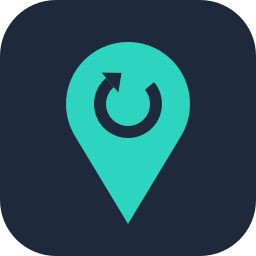

# Richardson Resources' Repository

Unraid [Community Applications](https://unraid.net/community/apps) templates
maintained by [Richardson Resources](https://www.richardsonresources.com).

Community Applications reads this repository once it is registered, so every
template here appears in the **Apps** tab under *Richardson Resources'
Repository*. Adding an app is a matter of adding one XML file; nothing changes
on the Community Applications side.

## Apps

| App | Image | Source and support | Template |
| --- | --- | --- | --- |
|  **No Fixed Address** – self-hosted dynamic DNS for Cloudflare DNS | `ghcr.io/mdr6273/no-fixed-address:latest` | [Project](https://github.com/mdr6273/no-fixed-address) · [Issues](https://github.com/mdr6273/no-fixed-address/issues) | [templates/nofixedaddress.xml](templates/nofixedaddress.xml) |

Questions and bug reports about an app go to that app's own issue tracker,
linked above and from the template. Problems with a template itself, such as
a wrong default or a missing field, go to [this repository's issues](https://github.com/mdr6273/unraid-apps/issues).

## Installing an app

**From the Apps tab:** search for the app by name and select **Install**. The
template's fields, defaults and descriptions come from this repository.

**Manually,** if the app does not show in the Apps tab yet or you prefer not
to use it: open a terminal on the server (the `>_` icon in the web UI),
download the template into Unraid's user templates folder, then choose it from
the **Template** list under **Docker** → **Add Container**.

```sh
wget -O /boot/config/plugins/dockerMan/templates-user/my-No-Fixed-Address.xml \
  https://raw.githubusercontent.com/mdr6273/unraid-apps/main/templates/nofixedaddress.xml
```

Setup instructions for each app are on its project page.

## Layout

| Path | What it is |
| --- | --- |
| `ca_profile.xml` | The repository's profile in Community Applications: description, icon and homepage. It has to stay in the repository root, with a non-empty `<Profile>`. |
| `templates/` | One XML file per Docker application. |
| `icons/` | The icons the templates point at. Keep each icon's file name stable, because installed containers keep its URL. |
| `plugins/` | One XML wrapper per Unraid plugin. Not present yet; see below. |

Only `ca_profile.xml` is special to Community Applications. The folder names
are a convention, taken from Unraid's
[starter repository](https://github.com/unraid/unraid-community-apps-starter).

## Adding another app

1. Write `templates/<app>.xml` as a `<Container version="2">` template. Start
   from [templates/nofixedaddress.xml](templates/nofixedaddress.xml) or the
   starter repository's
   [example](https://github.com/unraid/unraid-community-apps-starter/blob/main/templates/example-app.xml),
   and give the new app its own:
   - `<Name>`, `<Repository>` (the image, with its tag) and `<Registry>`;
   - `<Project>` (the app's source repository) and `<Support>` (its issue
     tracker or support thread);
   - `<Overview>`, `<Category>`, `<Requires>` and `<Config>` entries that match
     the app's own settings and defaults;
   - `<Icon>`: put the image in `icons/` and use its raw URL,
     `https://raw.githubusercontent.com/mdr6273/unraid-apps/main/icons/<app>.png`;
   - `<TemplateURL>`: the raw URL of this exact file,
     `https://raw.githubusercontent.com/mdr6273/unraid-apps/main/templates/<app>.xml`.
     Community Applications uses it to identify the template, so it must match
     the path the file is committed at.
2. Add the icon to `icons/`.
3. [Validate](#validating) the XML.
4. Add a row to the table above, then commit and push to `main`.

That is all. The repository is registered with Community Applications once,
and it picks up every template in it on its next build, so a new app needs no
new submission. The submit page at <https://ca.unraid.net/submit> has
**Validate** and **Scan** buttons that check the whole repository against
Community Applications' rules whenever you want a second opinion.

**Plugins** work the same way with a `<Plugin>` wrapper under `plugins/`,
whose `<PluginURL>` is the raw URL of the `.plg` file. Community Applications
reviews plugin submissions by hand, so a first plugin takes longer to appear.
The starter repository has an
[example](https://github.com/unraid/unraid-community-apps-starter/blob/main/plugins/example-plugin.xml).

## Validating

Both checks parse the XML and fail on a syntax error. Then read the file once
more for the fields above: Community Applications needs `<Name>` and
`<Repository>` at a minimum, and `<TemplateURL>` must be the raw URL of the
file you are editing.

```powershell
# PowerShell
Get-ChildItem ca_profile.xml, templates\*.xml | ForEach-Object { [xml](Get-Content -Raw $_) | Out-Null; "ok: $($_.Name)" }
```

```sh
# Any shell with Python
for f in ca_profile.xml templates/*.xml; do python3 -c 'import sys, xml.dom.minidom; xml.dom.minidom.parse(sys.argv[1])' "$f" && echo "ok: $f"; done
```

## The copy in the No Fixed Address repository

[No Fixed Address](https://github.com/mdr6273/no-fixed-address) published its
template from its own repository before this one existed, so its `unraid/`
folder keeps a mirror of `templates/nofixedaddress.xml` and the icon for
older links and installed containers. The template is edited here; the mirror
is refreshed by copying this file over it, as described in that folder's
README. Any other app that keeps such a copy should do the same.

## License

[MIT](LICENSE), © 2026 Mike Richardson. The No Fixed Address template and
icons come from the
[no-fixed-address](https://github.com/mdr6273/no-fixed-address) repository,
which is published under the same MIT license by the same author.
